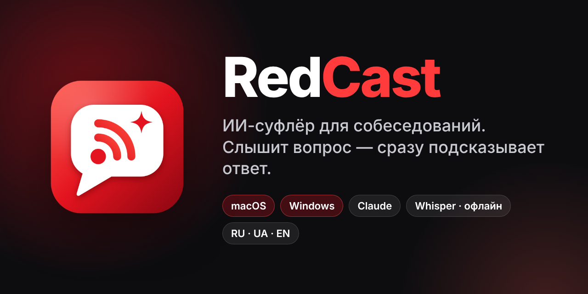
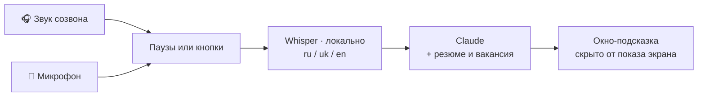

<p align="center">
  
</p>

<p align="center">
  
  
  
  <a href="LICENSE"></a>
</p>

<p align="center">
  <b>RedCast</b> слушает созвон, распознаёт русскую и украинскую речь прямо на вашем компьютере<br>
  и за пару секунд показывает готовый ответ от <b>Claude</b> в маленьком окне, невидимом при демонстрации экрана.
</p>

<p align="center">
  <a href="https://github.com/Shelt00n/RedCast/releases/latest/download/RedCast-Windows.zip"><b>⬇ Скачать для Windows</b></a>
  &nbsp;·&nbsp;
  <a href="https://github.com/Shelt00n/RedCast/releases/latest/download/RedCast-macOS.zip"><b>⬇ Скачать для macOS</b></a>
</p>

---

## Возможности

| | |
|---|---|
| 🎧 **Слышит созвон** | Zoom, Google Meet, Teams, Telegram, Discord, браузер. Звук берётся прямо из системы, виртуальные аудиодрайверы не нужны |
| 🗣 **Русский и украинский** | Whisper Large v3 Turbo работает локально, офлайн. Есть словарь терминов и фильтр «фантомных» фраз Whisper |
| ⚡ **Быстрый ответ** | Ответ появляется по мере генерации. Резюме и инструкции кэшируются, соединение прогревается заранее |
| 🧠 **Claude** | Opus 5.5, Sonnet 5.5 или Haiku 5.5. Через API-ключ или через вашу подписку Claude Pro/Max (Claude Code) |
| 🎯 **Два режима** | **Авто**: сам находит вопросы. **По кнопкам**: «Интервьюер» и «Я», первое нажатие начинает запись, второе даёт ответ |
| 📷 **Задачи с экрана** | Одно сочетание клавиш, и скриншот задачи (live coding, тест) уходит в Claude |
| 🙈 **Невидим в демонстрации** | Окно скрыто от Zoom, Meet и Teams. Нет иконки в панели задач или Dock, есть сквозные клики |
| ⌨️ **Свои горячие клавиши** | Каждое действие можно переназначить |
| 👤 **Ваш профиль** | Резюме, вакансия и ваши указания: ответы опираются на ваш реальный опыт |
| 🔇 **Различает голоса** | Интервьюер и вы слышатся раздельно. Эхоподавление и фильтр повторов работают даже без наушников |
| 📝 **История** | Расшифровка и подсказки каждого собеседования сохраняются в Markdown |

## Быстрый старт

### Windows
1. Скачайте **[RedCast-Windows.zip](https://github.com/Shelt00n/RedCast/releases/latest/download/RedCast-Windows.zip)** и распакуйте.
2. Запустите `RedCast.exe`. Если Windows покажет предупреждение, нажмите «Подробнее» → «Выполнить в любом случае».
3. Откройте «Настройки» → вставьте API-ключ или выберите подписку → «Проверить соединение».

📖 Подробно: **[windows/README.md](windows/README.md)**

### macOS (Apple Silicon)
1. Скачайте **[RedCast-macOS.zip](https://github.com/Shelt00n/RedCast/releases/latest/download/RedCast-macOS.zip)**, распакуйте и перетащите `RedCast.app` в «Программы».
2. Один раз выполните в Терминале:
   ```bash
   xattr -dr com.apple.quarantine /Applications/RedCast.app
   ```
3. Запустите RedCast и разрешите «Запись экрана и системного звука» и микрофон.

📖 Подробно: **[macos/README.md](macos/README.md)**

## Обновление

RedCast обновляется сам. Когда выходит новая версия, в окне появляется зелёная плашка **«Доступна новая версия → Обновить»**. Нажмите, и приложение скачает обновление с GitHub, заменит себя и перезапустится. Настройки, резюме и модель речи сохраняются. Проверить вручную можно в «Настройки → 6. Обновления».

## Как это работает



- Звук **не покидает компьютер**: распознавание работает локально. В Claude уходит только текст вопроса и ваш профиль.
- API-ключ хранится в Связке ключей macOS или в зашифрованном виде в учётной записи Windows.

## Подключение Claude

| Способ | Скорость | Оплата |
|---|---|---|
| **API-ключ** (platform.claude.com) | быстрее всего, есть fast mode | по факту, около $1–3 за час собеседования |
| **Подписка Claude Pro/Max** через Claude Code | на 0,5–1 с медленнее | входит в подписку, расходует её общий лимит |

## Сборка из исходников

| Платформа | Требования | Команда |
|---|---|---|
| macOS | macOS 14+, Xcode 16+ | `cd macos && bash build_app.sh` |
| Windows | .NET 8 SDK | `dotnet publish windows/RedCast.csproj -c Release -o out` |

Каждый тег `v*` автоматически собирает обе версии в GitHub Actions и публикует релиз.

## Структура репозитория

```
RedCast/
├── macos/          Swift / SwiftUI · ScreenCaptureKit · WhisperKit (CoreML)
├── windows/        C# / WPF · NAudio (WASAPI) · Whisper.net (Vulkan / CPU)
├── assets/         логотип, баннер, иконки
└── .github/        сборка и релизы
```

## Лицензия

[MIT](LICENSE). RedCast — независимый проект, не связанный с Anthropic. Пользуйтесь ответственно: правила собеседований у компаний разные.
